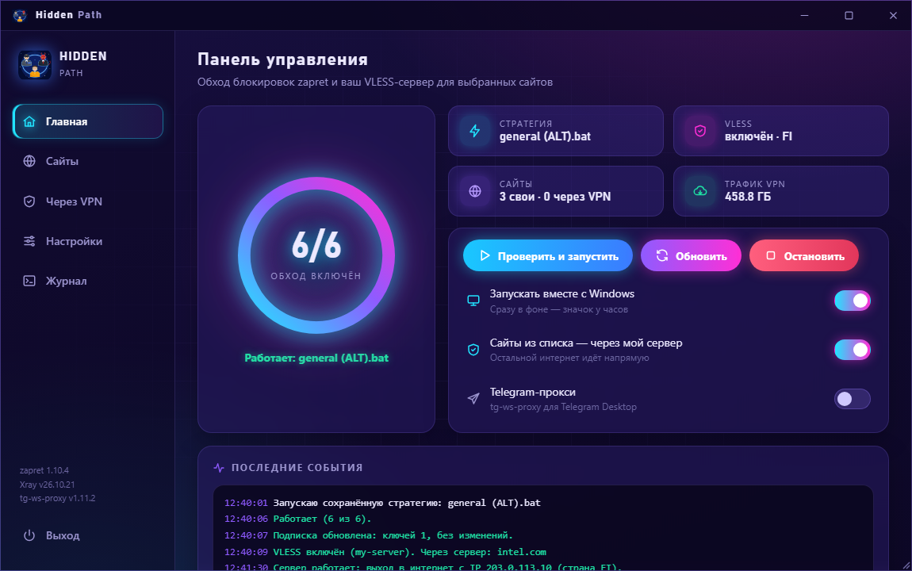
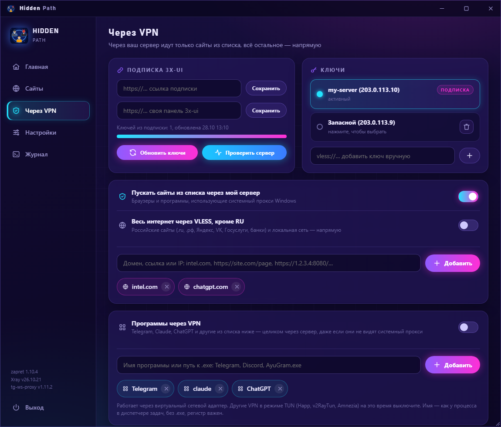
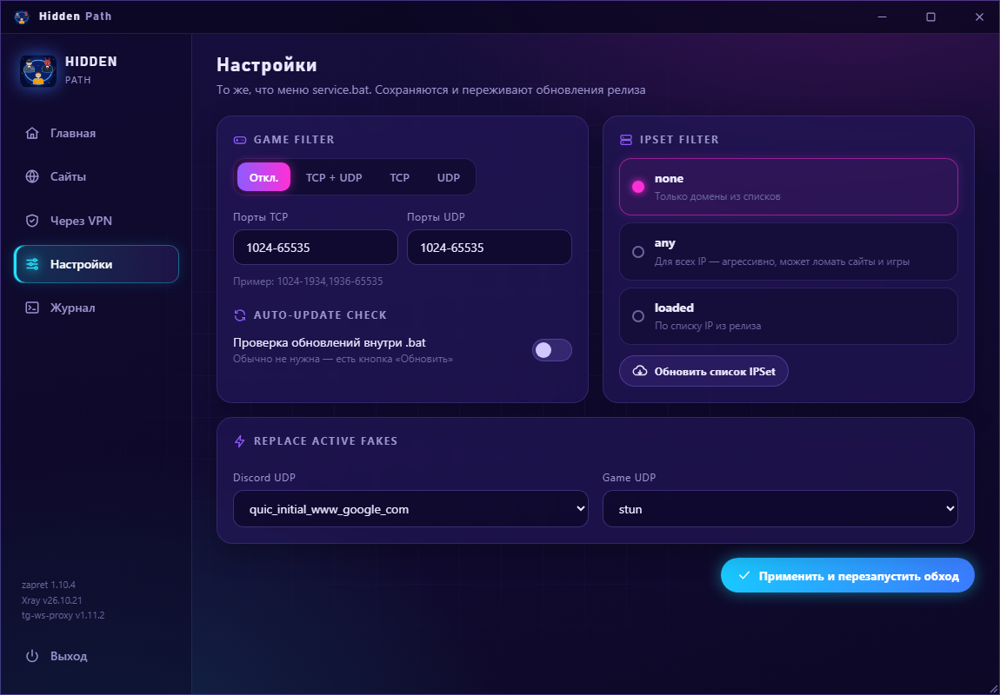

<div align="center">


# Hidden Path

**Обход блокировок для Windows в одном окне:** zapret, свой сервер VLESS и прокси для Telegram.

[](https://github.com/NapsterFO/HiddenPath/releases/latest/download/HiddenPath-Setup.exe)




</div>

## Что умеет

- **Обход блокировок через zapret.** Скачивает свежий релиз [zapret-discord-youtube](https://github.com/Flowseal/zapret-discord-youtube), сам перебирает стратегии и оставляет ту, при которой у вас открываются YouTube и Discord. Свои сайты добавляются в список одной строкой.
- **Свой сервер VLESS (Xray).** Вставьте ссылку подписки 3x-ui или ключ `vless://`. Через сервер идут только сайты из вашего списка, остальное напрямую. Если ключ перестал работать, программа сама найдёт рабочий в подписке.
- **Весь интернет через VLESS, кроме российских сайтов.** Отдельный тумблер: зарубежное идёт через сервер, а `.ru`, `.рф`, Госуслуги, банки и локальная сеть напрямую.
- **Программы через VPN.** Telegram, Claude, ChatGPT и любые программы из вашего списка идут через сервер целиком, даже если не видят системный прокси (режим TUN).
- **Сайты целиком.** К сайту из списка автоматически добавляются его служебные домены: например, к `claude.com` добавляются `claude.ai` и `anthropic.com`, к YouTube его CDN.
- **Telegram-прокси** [tg-ws-proxy](https://github.com/Flowseal/tg-ws-proxy) для Telegram Desktop.
- **Удобство:** работает в фоне у часов, запускается вместе с Windows, все настройки `service.bat` вынесены в окно, а zapret и Xray обновляются кнопкой.
- **Обновления программы.** Hidden Path сам сообщает о новой версии и ставит её кнопкой «Обновить приложение», без ручного скачивания.

<div align="center">
 
</div>

## Установка

1. Скачайте [**HiddenPath-Setup.exe**](https://github.com/NapsterFO/HiddenPath/releases/latest/download/HiddenPath-Setup.exe) со страницы [релизов](https://github.com/NapsterFO/HiddenPath/releases).
2. Запустите установщик и, если нужно, отметьте галочки «Запускать вместе с Windows» и «Ярлык на рабочем столе».
3. При первом запуске программа сама скачает zapret и подберёт стратегию. Это занимает около минуты.

Программе нужны права администратора: драйвер WinDivert (zapret) и сетевой адаптер (режим TUN) без них не работают. Антивирус может ругаться на `winws.exe` из zapret. Это известная история с WinDivert, подробности есть в [репозитории Flowseal](https://github.com/Flowseal/zapret-discord-youtube).

## Свой сервер VLESS

Для обхода через zapret сервер не нужен. Вкладка «Через VPN» нужна, только если у вас есть свой сервер, например с панелью [3x-ui](https://github.com/MHSanaei/3x-ui):

- **Подписка:** в 3x-ui откройте «Клиенты» → «Поделиться» → ссылку подписки и вставьте её в поле «Подписка 3x-ui».
- **Ключ:** или вставьте ключ `vless://…` вручную.
- **Панель:** по желанию сохраните ссылку на свою панель 3x-ui, и она будет открываться кнопкой.

В программе нет чужих ключей и серверов: всё, что идёт через VPN, идёт только через ваш сервер.

## Благодарности

Отдельное спасибо **[Flowseal](https://github.com/flowseal)**: Hidden Path вдохновлён его проектами и объединяет в одном приложении несколько разных программ и функций.

- [Flowseal/zapret-discord-youtube](https://github.com/Flowseal/zapret-discord-youtube) — сборка zapret со стратегиями для Windows.
- [Flowseal/tg-ws-proxy](https://github.com/Flowseal/tg-ws-proxy) — прокси для Telegram Desktop.
- [bol-van/zapret](https://github.com/bol-van/zapret) — сам zapret.
- [XTLS/Xray-core](https://github.com/XTLS/Xray-core) — VLESS, маршрутизация и TUN.
- [pywebview](https://github.com/r0x0r/pywebview), [pystray](https://github.com/moses-palmer/pystray), [Inno Setup](https://jrsoftware.org/isinfo.php).

zapret, tg-ws-proxy и Xray не входят в установщик: программа скачивает их с официальных страниц релизов на GitHub.

## Сборка из исходников

Нужны Python 3.12+ и [Inno Setup 6](https://jrsoftware.org/isinfo.php). Запустите:

```bat
build_installer.bat
```

Готовый установщик появится в `installer\HiddenPath-Setup.exe`.
