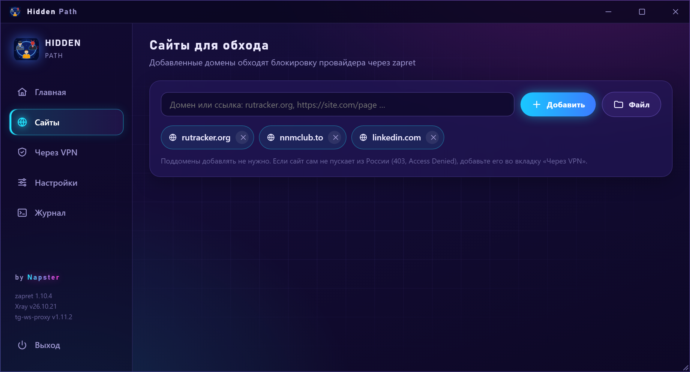

<div align="center">


# Hidden Path

**Обход блокировок для Windows в одном окне.**<br>
YouTube, Discord и заблокированные сайты работают через zapret, без VPN. Сайты, которые сами не пускают из России, идут через ваш сервер VLESS. Остальной интернет идёт напрямую.

[](https://github.com/NapsterFO/HiddenPath/releases/latest/download/HiddenPath-Setup.exe)


</div>

## Как это работает

У каждого сайта свой путь, и выбираете его вы:

| Путь | Для чего | Пример |
|---|---|---|
| **zapret** | Сайт режет провайдер: долго грузится, обрывается соединение | YouTube, Discord, rutracker.org |
| **Ваш сервер VLESS** | Сайт сам не пускает из России: «403», «Access Denied», «недоступно в вашем регионе» | intel.com, chatgpt.com, Claude |
| **Напрямую** | Всё остальное | банки, Госуслуги, игры, `.ru` |

Банки и российские сайты не видят иностранный IP, а лишние сайты не замедляются.

## Что умеет

- **zapret без настройки.** Программа скачивает свежий [zapret-discord-youtube](https://github.com/Flowseal/zapret-discord-youtube), перебирает стратегии и оставляет ту, при которой у вас всё открывается. Свой сайт добавляется одной строкой: можно вставить ссылку прямо из браузера.
- **Свой сервер VLESS (Xray).** Вставьте ссылку подписки 3x-ui или ключ `vless://`. Если ключ перестал работать, программа сама найдёт рабочий в подписке.
- **Весь интернет через VLESS, кроме RU.** Один переключатель: зарубежные сайты идут через сервер, а `.ru`, `.рф`, Яндекс, VK, Госуслуги, банки и локальная сеть идут напрямую.
- **Программы через VPN.** Telegram, Claude, ChatGPT и любые программы из вашего списка идут через сервер целиком, даже если не видят системный прокси (режим TUN).
- **Сайты целиком.** К сайту из списка сами добавляются его служебные домены: к `claude.com` добавляются `claude.ai` и `anthropic.com`, к YouTube его CDN.
- **Прокси для Telegram Desktop** [tg-ws-proxy](https://github.com/Flowseal/tg-ws-proxy). Работает без своего сервера.
- **Все настройки `service.bat` в окне:** Game Filter, IPSet, fake-файлы. Они не сбрасываются при обновлении zapret.
- **Работает в фоне.** Значок у часов, запуск вместе с Windows, zapret и Xray обновляются кнопкой.
- **Обновляется сама.** Когда выходит новая версия, Hidden Path показывает уведомление и ставит её кнопкой «Обновить приложение».

<div align="center">
 
<br>

</div>

## Установка

1. Скачайте [**HiddenPath-Setup.exe**](https://github.com/NapsterFO/HiddenPath/releases/latest/download/HiddenPath-Setup.exe).
2. Запустите установщик и, если нужно, отметьте «Запускать вместе с Windows» и «Ярлык на рабочем столе».
3. При первом запуске программа сама скачает zapret и подберёт стратегию. Это занимает около минуты.

Дальше обновления ставятся из самой программы.

Программе нужны права администратора: без них не работают драйвер WinDivert (zapret) и сетевой адаптер (режим TUN). Установщик не подписан, поэтому Windows может показать «Система Windows защитила ваш компьютер»: нажмите «Подробнее» → «Выполнить в любом случае». Антивирус может ругаться на `winws.exe` из zapret. Это известное ложное срабатывание на WinDivert, подробности в [репозитории zapret-discord-youtube](https://github.com/Flowseal/zapret-discord-youtube).

## Свой сервер VLESS

Для zapret сервер не нужен. Вкладка «Через VPN» пригодится, только если у вас есть свой сервер, например с панелью [3x-ui](https://github.com/MHSanaei/3x-ui):

- **Подписка:** в 3x-ui откройте «Клиенты» → «Поделиться», скопируйте ссылку подписки и вставьте её в поле «Подписка 3x-ui».
- **Ключ:** или вставьте ключ `vless://…` вручную.
- **Панель:** по желанию сохраните ссылку на свою панель 3x-ui, и она будет открываться кнопкой.

В программе нет чужих ключей и серверов: всё, что идёт через VPN, идёт только через ваш сервер. Ключи хранятся только у вас на компьютере.

## Если что-то не работает

- **Сайт из списка «Сайты» не открывается.** Скорее всего, его блокируют по IP. Включите в «Настройках» IPSet `loaded` или добавьте сайт во вкладку «Через VPN».
- **Сайт пишет «403» или «недоступно в вашем регионе».** zapret тут не поможет: добавьте сайт во вкладку «Через VPN».
- **«Сертификат сайта не прошёл проверку».** HTTPS перехватывает антивирус (проверка защищённых соединений в Kaspersky, ESET и т. п.) или другой VPN. Добавьте Hidden Path в исключения.
- **Другой VPN в режиме TUN** (Happ, v2RayTun, Amnezia) на время работы «Программ через VPN» выключите.

## Благодарности

Отдельное спасибо **[Flowseal](https://github.com/flowseal)**: Hidden Path вдохновлён его проектами и объединяет в одном приложении несколько разных программ и функций.

- [Flowseal/zapret-discord-youtube](https://github.com/Flowseal/zapret-discord-youtube) — сборка zapret со стратегиями для Windows.
- [Flowseal/tg-ws-proxy](https://github.com/Flowseal/tg-ws-proxy) — прокси для Telegram Desktop.
- [bol-van/zapret](https://github.com/bol-van/zapret) — сам zapret.
- [XTLS/Xray-core](https://github.com/XTLS/Xray-core) — VLESS, маршрутизация и TUN.
- [pywebview](https://github.com/r0x0r/pywebview), [pystray](https://github.com/moses-palmer/pystray), [Inno Setup](https://jrsoftware.org/isinfo.php).

zapret, tg-ws-proxy и Xray не входят в установщик: программа скачивает их с официальных страниц релизов на GitHub.

## Сборка из исходников

Нужны Python 3.12+ и [Inno Setup 6](https://jrsoftware.org/isinfo.php). Запустите:

```bat
build_installer.bat
```

Готовый установщик появится в `installer\HiddenPath-Setup.exe`.

<div align="center"><sub>by <b>Napster</b></sub></div>
